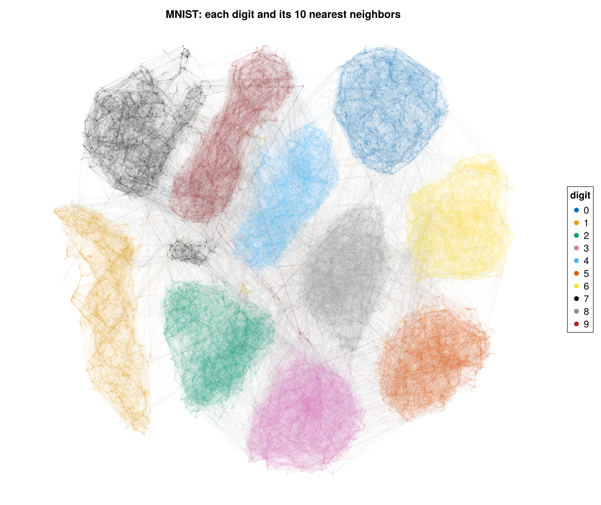
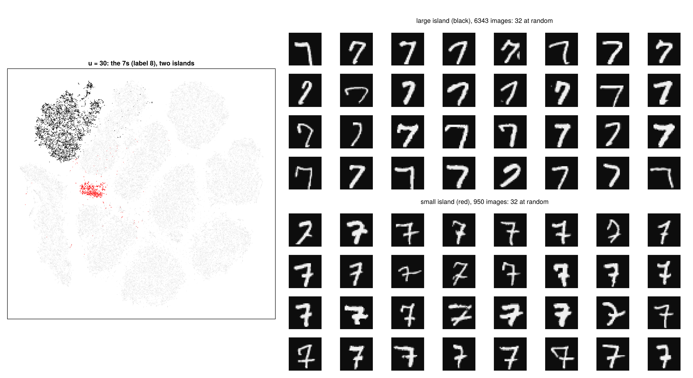

# Parallel & Distributed Computer Systems 2026
# Homework 1
# Seeing a Graph: t-SNE with Barnes–Hut

## Deadline: Monday, November 30, 2026, 23:59

A graph with a million nodes cannot be drawn by hand. *t-distributed
stochastic neighbor embedding* (t-SNE) places each node $i$ at a point
$y_i$ in the plane, so that nodes that are strongly connected end up close
and the rest are pushed apart. Groups of the graph nodes become islands you can see.
The figure above shows it on the MNIST digits. Look at the left panels
first: the islands appear before we color them.

We draw only the points; the edges would hide them. Here they are once,
for each digit its 10 nearest neighbors: within a digit in its color,
across digits in gray. Some neighbors are other digits (a 4 that looks
like a 9), but 97.5% of the edges stay within the digit. The neighbors
of a node mostly agree with each other, and that is why t-SNE can pull
each group together into an island.

t-SNE pictures are easy to misread: sizes of islands and distances
between them often mean little. Play with the interactive examples of
[3] to see what t-SNE shows and what it does not.

In this homework you will compute the heart of t-SNE, one gradient of its
objective, in parallel, for large sparse graphs. The work splits into a
sparse part, a sparse matrix times a dense matrix, and a dense part,
interactions among all pairs of nodes, that a quadtree and the
Barnes–Hut approximation [2] reduce from $O(n^2)$ to about $O(n \log n)$.
We follow van der Maaten [1].

## The problem

### From the graph to probabilities

The input is an undirected graph $G(V, E)$ with $n$ nodes and a sparse,
symmetric, nonnegative adjacency matrix $W$ with zero diagonal: $w_{ij} > 0$
is the *affinity* of nodes $i$ and $j$ (larger means more similar; it is
not a distance). Unweighted graphs have $w_{ij} = 1$ on every edge.

For each node $i$, with $d_i$ neighbors, define the conditional
probabilities over its neighbors

$$
p_{j|i} = \frac{w_{ij}^{\beta_i}}{\sum_{k} w_{ik}^{\beta_i}}, \qquad (i, j) \in E,
$$

where the exponent $\beta_i \ge 0$ is chosen so that the row has
*perplexity* $\min(u, d_i)$:

$$
H_i = -\sum_j p_{j|i} \log p_{j|i} = \log \min(u, d_i).
$$

$\beta_i$ is a *local scale*: it sharpens the weights of node $i$ until
the node has about $u$ effective neighbors. The entropy decreases as
$\beta_i$ grows, so $\beta_i$ is found by bisection, independently for
every node: stop when $|H_i - \log \min(u, d_i)| < 10^{-5}$, or after a
fixed number of steps. If all weights of node $i$ are equal, or
$u \ge d_i$, the row is uniform, $p_{j|i} = 1/d_i$. To avoid overflow, compute
$(w_{ij}/\max_k w_{ik})^{\beta_i}$; the ratio is the same. Finally,
symmetrize:

$$
p_{ij} = \frac{p_{j|i} + p_{i|j}}{2n}.
$$

$P$ has the sparsity pattern of $W$, is symmetric, and sums to 1. It is
computed **once**.

### The embedding and the objective

For points $y_1, \ldots, y_n$ in the plane (a $2 \times n$ matrix $Y$), the
heavy-tailed Student-t kernel defines

$$
q_{ij} = \frac{(1 + \Vert y_i - y_j\Vert ^2)^{-1}}{Z}, \qquad
Z = \sum_{k \ne l} (1 + \Vert y_k - y_l\Vert ^2)^{-1}.
$$

Note that $Q$ is dense: every pair of points interacts. t-SNE finds $Y$
that minimizes the Kullback–Leibler divergence

$$
C(Y) = \mathrm{KL}(P \thinspace \Vert \thinspace Q) = \sum_{i \ne j} p_{ij} \log \frac{p_{ij}}{q_{ij}}.
$$

### The gradient

Write $d_{ij}^2 = \Vert y_i - y_j\Vert ^2$. Since $\log q_{ij} = -\log(1 + d_{ij}^2) - \log Z$
and $\sum p_{ij} = 1$,

$$
C = \sum_{i \ne j} p_{ij} \log p_{ij} + \sum_{i \ne j} p_{ij} \log(1 + d_{ij}^2) + \log Z.
$$

The first sum does not depend on $Y$. In the second, $y_i$ appears in the
terms $(i, j)$ and $(j, i)$, so its derivative is
$4 \sum_j p_{ij} (1 + d_{ij}^2)^{-1} (y_i - y_j)$. For the last,
$\partial \log Z / \partial y_i = (1/Z)\thinspace \partial Z / \partial y_i$, with
$\partial Z / \partial y_i = -4 \sum_j (1 + d_{ij}^2)^{-2} (y_i - y_j)$,
again from the terms $(i, j)$ and $(j, i)$. Together,

$$
\frac{\partial C}{\partial y_i}
= 4 \sum_{j} (p_{ij} - q_{ij}) (1 + d_{ij}^2)^{-1} (y_i - y_j)
= 4 \left( F^{\mathrm{attr}}_i - F^{\mathrm{rep}}_i \right),
$$

an attractive force along the edges and a repulsive force among all pairs:

$$
F^{\mathrm{attr}}_i = \sum_{j : (i,j) \in E} p_{ij} (1 + d_{ij}^2)^{-1} (y_i - y_j),
\qquad
F^{\mathrm{rep}}_i = \frac{1}{Z} \sum_{j \ne i} (1 + d_{ij}^2)^{-2} (y_i - y_j).
$$

**Attraction: a sparse × dense product.** With the sparse matrix
$A_{ij} = p_{ij}(1 + d_{ij}^2)^{-1}$ (pattern of $P$) and its row sums on a
diagonal $D$, $F^{\mathrm{attr}} = Y (D - A)$, that is,
$(D - A)\thinspace Y^{\mathsf{T}}$: one product of a sparse $n \times n$ matrix
with a dense $n \times 2$ matrix, where the entries of
$A$ are computed on the fly from $P$ and $Y$. Its cost is $O(\mathrm{nnz}(P))$.

**Repulsion: a quadtree and Barnes–Hut.** Computed directly,
$F^{\mathrm{rep}}$ and $Z$ cost $O(n^2)$: $10^{12}$ pairs for a million
nodes. Barnes–Hut [2], as used in [1, Sec. 4.2], puts the points in a quadtree, whose
cells are squares split into four quadrants down to cells with few
points; each cell keeps the number of its points $N_{\mathrm{cell}}$ and
their center of mass $y_{\mathrm{cell}}$. For each point $y_i$, walk the
tree from the root. If a cell satisfies

$$
\frac{r_{\mathrm{cell}}}{\Vert y_i - y_{\mathrm{cell}}\Vert } < \theta,
$$

with $r_{\mathrm{cell}}$ the length of the cell's diagonal (use the
diagonal, as written here; some implementations use half the side,
which accepts larger cells and gives larger errors), all its points act as one:
the cell adds $N_{\mathrm{cell}}(1 + d^2)^{-2}(y_i - y_{\mathrm{cell}})$
to the unnormalized repulsion and $N_{\mathrm{cell}}(1 + d^2)^{-1}$ to $Z$,
where $d = \Vert y_i - y_{\mathrm{cell}}\Vert $. Otherwise, open the cell and visit
its children. At a leaf, add its points one by one (except $y_i$ itself).
Both sums are accumulated in the same walk; divide by $Z$ at the end.

### The two parameters

- **$u$, the perplexity**, about how many neighbors each node listens to.
  It changes $P$, not its pattern, and so the picture, not the cost (see
  the figure: compare $u = 30$ and $u = 10$). In unweighted graphs it
  does nothing: every row is uniform.
- **$\theta$, the opening angle**, trades accuracy for speed: $\theta = 0$
  opens every cell (the exact $O(n^2)$ sum); larger $\theta$ accepts
  bigger, closer cells.

For this homework, **$u = 10$ and $\theta = 0.5$**.

### Which quadtree

The tree is yours to design. Two choices, both fine:

- **Adaptive.** Split a cell only while it holds more than $m$ points
  (its *leaf capacity*). The tree follows the points: deep where they
  are dense, shallow where they are sparse.
- **Fixed depth.** Cut the bounding square into a $2^L \times 2^L$ grid
  of leaves and keep every level: a full tree whose level $l$ is a
  dense array of $4^l$ cells. Building it is a counting sort of the
  points by leaf, then sums of four children per cell, level by level:
  simple, and easy to parallelize.

Either way, the size of the leaves decides the time. Leaves of a few
points mean a deep tree with many cells to visit; leaves of hundreds of
points mean long direct sums. In our tests on MNIST ($n = 70{,}000$), a
fixed grid of $8 \times 8$ was barely faster than the direct $O(n^2)$
sum and $16 \times 16$ only twice as fast, while $128 \times 128$ (about 8 points per occupied
leaf) was over 20 times faster, slightly faster than an adaptive tree
with leaves of at most 16 points. Clustered points crowd the cells of a
fixed grid, which an adaptive tree avoids. Report the leaf capacity
$m$ or the depth $L$ you chose, and the measurements that justify it.

## The data

We provide three graphs from the [SuiteSparse Matrix
Collection](https://sparse.tamu.edu), each its largest connected component,
without self-loops:

| graph | nodes | edges | degree min / median / max | weights | labels |
|---|---|---|---|---|---|
| `k49_norm_10NN` | 38,547 | 309,079 | 10 / 14 / 551 | real | 49 classes, 0–48 |
| `com-Amazon` | 334,863 | 925,872 | 1 / 4 / 549 | 1 | communities, 5% of nodes (0: none) |
| `coPapersDBLP` | 540,486 | 15,245,729 | 1 / 34 / 3,299 | 1 | none |

Each graph comes in a MATLAB file (`.mat`, version 7.3, compressed) with
the sparse matrix `A` ($W$ above) and a vector `label`, only for
coloring pictures: the class for `k49_norm_10NN`; for `com-Amazon`, one
of its top communities, or 0 for the 95% of nodes in none.

**Getting started.** On [github.com/AUTh-CSAL/graph-t-sne](https://github.com/AUTh-CSAL/graph-t-sne),
click *Use this template* to make your own repository, then open it in a
GitHub Codespace: the codespace installs gcc,
[OpenCilk](https://www.opencilk.org), and
[matio](https://github.com/tbeu/matio). The data are in `data/`. On your
own Ubuntu 24.04 machine (or WSL), clone your repository and run
`bash env/setup.sh`. On macOS, install `libmatio` with
[Homebrew](https://brew.sh) and OpenCilk's macOS release from
[opencilk.org](https://www.opencilk.org); use Homebrew's `gcc` (or
`libomp` with Apple's `clang`) for OpenMP. `starter/` has a small C reader for the data
(`data.h`) and a program that prints a summary of a graph:
`./starter/readdata data/k49_norm_10NN`. Use it, or convert the data
once to a format of your choice.

For each graph we also give the state $Y_0$ at which you compute the
gradient: `<graph>-Y0.mat` holds `Y0`, a $2 \times n$ matrix (in memory,
column $i$ holds the two coordinates of $y_i$), and the parameters `u`
and `theta`. $Y_0$ is the state of a full t-SNE run after 300
iterations; compute the plain gradient above at it (t-SNE's early
iterations multiply $P$ by a constant, the *early exaggeration* of [1];
not here).

To check your results, `<graph>-ref.mat` holds our $\beta$ (0 where the row is uniform), $F^{\mathrm{attr}}$,
$F^{\mathrm{rep}}$, and $Z$ at $Y_0$; the repulsion and $Z$ were
computed with Barnes–Hut at $\theta = 0.1$, close to exact. Your
$\beta$ and $F^{\mathrm{attr}}$ should agree with ours to about $10^{-4}$
for `k49_norm_10NN` (each $\beta_i$ is found only to the bisection
tolerance) and to round-off for the unweighted graphs. For
$F^{\mathrm{rep}}$, report the error
$\max |x - x_{\mathrm{ref}}| / \max |x_{\mathrm{ref}}|$, and for $Z$ the
relative error $|Z - Z_{\mathrm{ref}}| / Z_{\mathrm{ref}}$; at
$\theta = 0.5$ expect around $10^{-2}$ or less. A wrong cell
size, a forgotten self-interaction, or a wrong normalization gives errors
near 1.

**We may ask you to run a couple more graphs of about a million
nodes**, weighted or not, so do not tune your code just to these three.

## What to implement (C/C++)

1. Read $W$ and compute $P$ (local $\beta_i$ by bisection, then symmetrize).
2. At $Y_0$, compute $F^{\mathrm{attr}}$ with **your own** sparse ×
   dense kernel.
3. Build **your own** quadtree of $Y_0$ (adaptive or fixed depth) and compute $F^{\mathrm{rep}}$
   and $Z$ by **your own** Barnes–Hut walk.
4. Assemble the gradient $4(F^{\mathrm{attr}} - F^{\mathrm{rep}})$.

You may use libraries to read the files and to store sparse matrices,
but not for the sparse × dense product, the quadtree, or Barnes–Hut,
and not t-SNE code.

Parallelize the computation in steps 1–4 (not the file reading) with
[Pthreads](https://hpc-tutorials.llnl.gov/posix/),
[OpenMP](https://www.openmp.org/specifications/), and
[OpenCilk](https://www.opencilk.org): three versions, and a sequential
one to compare against. All four must agree. Save your $\beta$,
$F^{\mathrm{attr}}$, $F^{\mathrm{rep}}$, and $Z$ for each graph in your
repository.

For `k49_norm_10NN`, also compute the repulsion directly, $O(n^2)$, in
parallel. Is your Barnes–Hut faster? By how much? Below what $n$ is
the direct sum faster?

**Measure each phase separately**: $P$, attraction, quadtree
construction, centers of mass, the walk. Report run times against the
number of threads $p$, and across the graphs (against $n$ and the number
of edges). Explain what limits your speedup in each phase: for example,
the cost of a row of the sparse product is proportional to the degree,
and `coPapersDBLP` has nodes of degree 1 and of degree 3,299.

Run on any multicore machine you have access to: your laptop, a lab
machine, or a [GitHub Codespace](https://github.com/features/codespaces)
(the free monthly quota is counted in core-hours, so develop on 2 cores
and switch to a machine with more cores, if your quota allows, only for
the final measurements; one run takes seconds). State the machine in your report: processor, cores, hardware
threads, memory, compiler and flags.

## AI assistants, and what you should take away

Use them: they are part of how software is written today, and a weaker
submission is not better for having been written without them. But the
code is not the point of this homework; what you learn is. When you are
done, you should be able to explain, without notes:

- what t-SNE minimizes, and why its gradient splits into an attraction
  along the edges and a repulsion among all pairs;
- why the attraction is a sparse × dense product, what it costs, and
  what limits its speed (memory traffic, rows of very different lengths);
- how Barnes–Hut trades accuracy for time ($\theta$, the cell
  criterion, the leaf size), and what it costs to build and walk the tree;
- how you parallelized each phase in each of the three models, and why
  each phase scales the way it does on your machine.

So, besides the code and the measurements:

1. **Predict, then measure.** From your runs on `k49_norm_10NN` and
   `com-Amazon`, predict the time of each phase on `coPapersDBLP` before
   you run it.
   Report the prediction and the measurement, and explain the difference.
2. **One bug.** Describe one real bug you hit, a wrong result or a slow
   code: how you noticed it, how you found it, how you fixed it.
3. **In class**, we may ask you to change your code on the spot (count
   the cells each point visits, change how the work is scheduled) and to
   explain any number in your report.

## What to submit

- A **4-page report** (PDF): your approach (data structures, how you
  build the tree and walk it in parallel, how you split the work) and the
  analysis of your results.
- A **link to a GitHub repository** with your source code **and the data
  behind every plot and table** in the report (raw timings, the scripts
  that make the plots).
- A **5-slide presentation** to give *LIVE* in class in 4 minutes or less. Be ready to explain any part of your code.
- This is **individual** work. Cite any external sources you used,
  including AI assistants: say for what, and what they got wrong that
  you had to catch.

### Optional: see the picture

One gradient does not draw anything. If you are curious, iterate from
$Y_0$: for every point, $y_i \leftarrow y_i + v_i$, with
$v_i \leftarrow 0.8\thinspace v_i - 200\thinspace \gamma_i\thinspace g_i$, where $g_i$ is its
gradient and $\gamma_i$ its gain ($\gamma_i + 0.2$ when
$g_i \cdot v_i < 0$, $0.8\gamma_i$ otherwise, never below 0.01; start
with $v_i = 0$, $\gamma_i = 1$). A few hundred iterations, then color the
points by `label`. This is the optimizer of [1, Sec. 5.2] (momentum,
adaptive step sizes), with one change: [1] adapts a gain for each
coordinate, x and y separately, and on large graphs with little
structure that draws a cross along the axes in the early iterations.
One gain per point does not prefer any direction. (Can you see why the
cross appears?)

## Afterthought

How did MNIST become a graph? Each image was described by a vector of
features (histograms of the directions in which brightness changes,
HOG), each image
was linked to its 100 nearest images in that feature space, and the
distances $d$ became affinities $w = e^{-d^2}$. A whole process sits
between the images and the graph, and the picture depends on it. Other
graphs need no such process: the relations are the data. Products bought
together (`com-Amazon`), papers sharing authors (`coPapersDBLP`), actors
in the same movies, papers citing each other. t-SNE does not care where
the graph came from; what it shows you depends on it.

## References

[1] L. van der Maaten. Accelerating t-SNE using tree-based algorithms.
*Journal of Machine Learning Research*, 15:3221–3245, 2014.

[2] J. Barnes and P. Hut. A hierarchical $O(N \log N)$ force-calculation
algorithm. *Nature*, 324:446–449, 1986.

[3] M. Wattenberg, F. Viégas, and I. Johnson. How to use t-SNE
effectively. *Distill*, 2016. <https://distill.pub/2016/misread-tsne/>
